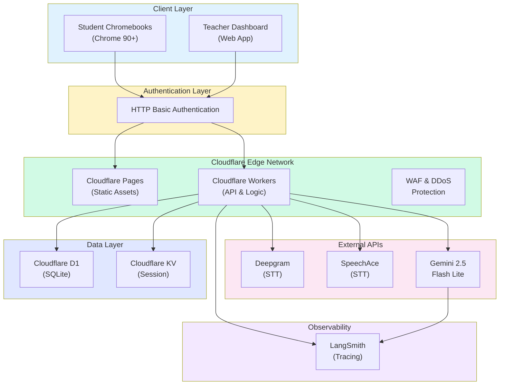
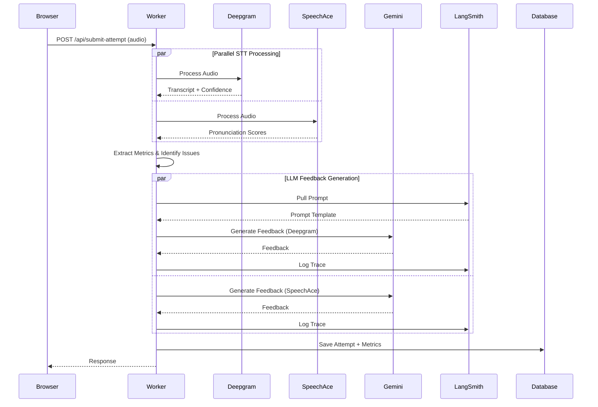
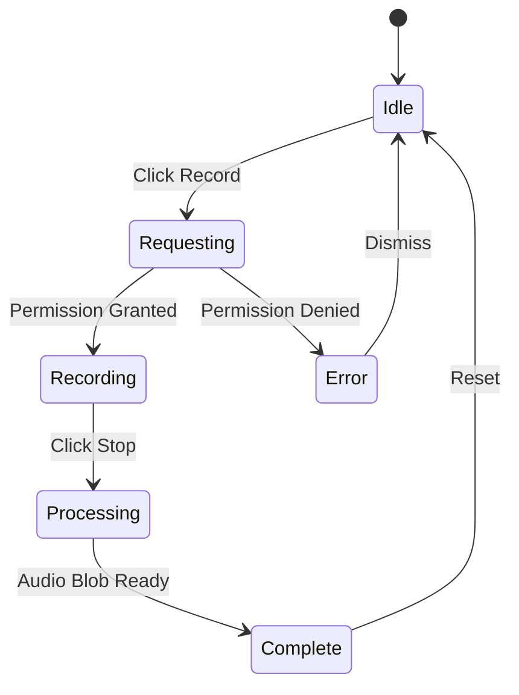
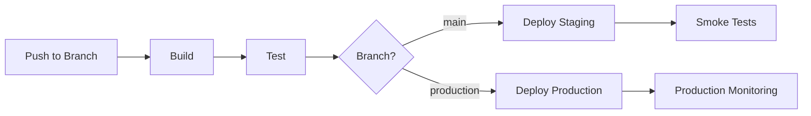

# ReadAssist AI - Technical Requirements Document (TRD)

## Document Information

| Field | Details |
|-------|---------|
| **Product Name** | ReadAssist AI - Reading Fluency Assessment Platform |
| **Document Type** | Technical Requirements Document |
| **Version** | 1.0 |
| **Author** | Engineering Team |
| **Date** | October 12, 2026 |
| **Status** | Draft |
| **Based On** | PRD v1.0, BRD v2.2 |

---

## 1. Executive Summary

### 1.1 Purpose

This Technical Requirements Document defines the architecture, technology stack, infrastructure, and implementation specifications for the ReadAssist AI Reading Fluency Assessment Platform. It translates product requirements into actionable technical specifications.

### 1.2 Scope

- System architecture and component design
- Technology stack selection and justification
- Database design and data models
- API specifications
- External service integrations
- Security and compliance requirements
- Performance and scalability targets
- Deployment and infrastructure

---

## 2. System Architecture

### 2.1 Architecture Overview

ReadAssist AI employs a **serverless, edge-first architecture** leveraging Cloudflare's global infrastructure for optimal performance and cost efficiency.



### 2.2 Architecture Principles

| Principle | Implementation |
|-----------|----------------|
| **Edge-First** | Cloudflare Workers execute at 275+ global edge locations |
| **Serverless** | No server management; auto-scaling built-in |
| **Stateless** | Session state stored in KV; workers remain stateless |
| **Privacy-By-Design** | Audio deleted immediately; no PII stored |
| **Dual Provider** | All attempts processed by both STT providers for comparison |

### 2.3 Key Design Decisions

| Decision | Rationale |
|----------|-----------|
| Cloudflare over AWS/Vercel | Sub-50ms cold starts, 77% lower costs, simpler whitelisting |
| D1 over PostgreSQL | Edge-native, zero cold start, sufficient for POC scale |
| HTTP Basic Auth over OAuth | Simplicity for POC; eliminates account management |
| Dual STT Processing | A/B testing requirement for provider selection |
| LangSmith Integration | Non-technical prompt editing, comprehensive tracing |

---

## 3. Technology Stack

### 3.1 Frontend

| Component | Technology | Version | Justification |
|-----------|------------|---------|---------------|
| Framework | React Router 7 (Remix) | 7.x | SSR support, Cloudflare integration |
| Styling | Tailwind CSS | 4.x | Utility-first, small bundle size |
| Audio Capture | Web Audio API | Native | Browser-native, no dependencies |
| Build Tool | Vite | 5.x | Fast builds, Cloudflare support |

### 3.2 Backend

| Component | Technology | Version | Justification |
|-----------|------------|---------|---------------|
| Runtime | Cloudflare Workers | - | Edge execution, auto-scaling |
| Database | Cloudflare D1 (SQLite) | - | Edge-native, zero cold start |
| Session Store | Cloudflare KV | - | Fast key-value access |
| ORM | Drizzle ORM | 0.30+ | Type-safe, D1-compatible |
| Authentication | HTTP Basic Auth | - | Simple, browser-native |

### 3.3 External Services

| Service | Provider | Purpose | Pricing |
|---------|----------|---------|---------|
| STT Provider 1 | Deepgram Nova-3 | Speech-to-text with word confidence | $0.0043/minute |
| STT Provider 2 | SpeechAce | Pronunciation scoring, WCPM | $125/month + overage |
| LLM | Gemini 2.5 Flash Lite | Feedback generation | $0.1/1M input, $0.4/1M output |
| Observability | LangSmith | Tracing, prompt management | Free tier (5,000 traces/month) |

### 3.4 Infrastructure

| Component | Service | Configuration |
|-----------|---------|---------------|
| Hosting | Cloudflare Pages | Automatic SSL, CDN |
| Compute | Cloudflare Workers | Auto-scaling, 275+ locations |
| Database | Cloudflare D1 | 5GB free tier |
| DDoS Protection | Cloudflare WAF | Included |

---

## 4. Data Architecture

### 4.1 Entity Relationship Diagram

```mermaid
erDiagram
    teachers ||--o{ classes : "has"
    teachers ||--o{ test_results : "owns"
    classes ||--o{ attempts : "contains"
    classes ||--o{ test_results : "has"
    tests ||--o{ sentences : "contains"
    tests ||--o{ attempts : "has"
    tests ||--o{ test_results : "has"
    sentences ||--o{ attempts : "references"
    sentences ||--o{ attempt_step : "references"
    sentences ||--o{ test_step_result : "references"
    attempts ||--|| attempt_stt : "has"
    attempts ||--o{ attempt_step : "contains"
    test_results ||--o{ test_step_result : "contains"

    teachers {
        int id PK
        string name
        string email UK
        timestamp created_at
        timestamp updated_at
    }

    classes {
        int id PK
        int teacher_id FK
        string name
        string code UK
        timestamp created_at
        timestamp updated_at
    }

    tests {
        int id PK
        string title
        real fluency_threshold
        int max_attempts_per_step
        timestamp created_at
        timestamp updated_at
    }

    sentences {
        int id PK
        int test_id FK
        string content
        int sequence_number
        timestamp created_at
        timestamp updated_at
    }

    attempts {
        string id PK
        string student_anonymous_id
        int class_id FK
        int test_id FK
        int sentence_id FK
        int step_number
        int attempt_number
        int paragraph_read_number
        string deepgram_transcript
        real deepgram_wcpm
        real deepgram_accuracy
        real deepgram_confidence
        real deepgram_fluency
        real speechace_wcpm
        real speechace_accuracy
        real speechace_fluency
        boolean speechace_has_irrelevant_speech
        string deepgram_teacher_feedback
        string speechace_teacher_feedback
        string highlighted_words
        boolean passed
        int duration_ms
        timestamp created_at
        timestamp updated_at
    }

    attempt_step {
        string attempt_sentence_id PK
        string attempt_id FK
        string student_anonymous_id
        int class_id FK
        int test_id FK
        int sentence_id FK
        int step_number
        int attempt_number
        int paragraph_read_number
        string deepgram_transcript
        real deepgram_wcpm
        real deepgram_accuracy
        real deepgram_fluency
        real speechace_wcpm
        real speechace_accuracy
        real speechace_fluency
        string words_skipped
        string words_added
        string words_highlighted
        string step_type
        boolean passed
        timestamp created_at
        timestamp updated_at
    }

    attempt_stt {
        string attempt_id PK_FK
        string raw_deepgram
        string raw_speechace
        string raw_gemini
    }

    test_results {
        int id PK
        string student_anonymous_id
        int teacher_id FK
        int class_id FK
        int test_id FK
        string finalized_at
        int wcpm
        int accuracy
        int fluency
        string ai_feedback_deepgram
        string ai_feedback_speechace
        string original_text
        string teacher_notes
        timestamp created_at
        timestamp updated_at
    }

    test_step_result {
        int id PK
        int test_results_id FK
        int sentence_id FK
        int paragraph_read_number
        int wcpm_deepgram
        int accuracy_deepgram
        int fluency_deepgram
        int wcpm_speechace
        int accuracy_speechace
        int fluency_speechace
        string words_skipped
        string words_added
        string words_highlighted
        int attempts
        string step_type
    }
```

### 4.2 Table Descriptions

| Table | Purpose | Records (Est.) |
|-------|---------|----------------|
| `teachers` | Teacher accounts | 5 (POC) |
| `classes` | Classroom cohorts | 5 (POC) |
| `tests` | Reading assessments | 3 (POC) |
| `sentences` | Individual sentences per test | ~15 (POC) |
| `attempts` | Student reading attempts | ~500+ (POC) |
| `attempt_step` | Per-sentence metrics within attempts | ~2,500+ |
| `attempt_stt` | Raw STT API responses | ~500+ |
| `test_results` | Finalized student results | ~100+ |
| `test_step_result` | Aggregated step results | ~500+ |

### 4.3 Data Privacy

| Data Type | Storage Policy |
|-----------|----------------|
| Audio Files | Deleted immediately after STT processing |
| Student Names | Anonymized to format: `J_Smith_7B3X` |
| Transcriptions | Retained for analysis |
| Metrics | Retained for analysis |
| Teacher Notes | Retained for analysis |
| PII | Not collected or stored |

---

## 5. API Specifications

### 5.1 API Overview

| Endpoint | Method | Description |
|----------|--------|-------------|
| `/api/start-session` | POST | Initialize student session |
| `/api/submit-attempt` | POST | Submit audio for processing |
| `/api/active-sessions` | GET | Get in-progress sessions |
| `/api/completed-sessions` | GET | Get completed sessions |
| `/api/student-detail-results` | GET | Get detailed student metrics |
| `/api/save-teacher-notes` | POST | Save teacher feedback |
| `/api/export-attempts-csv` | GET | Export attempts as CSV |
| `/api/export-results-csv` | GET | Export results as CSV |

### 5.2 Core API: Submit Attempt

**Endpoint**: `POST /api/submit-attempt`

**Request**:
```typescript
// Content-Type: multipart/form-data
{
  audio: File,              // WebM/Opus audio file (max 10MB)
  testId: number,
  classId: number,
  studentAnonymousId: string,
  stepNumber: number,
  attemptNumber: number,
  sentenceId: number
}
```

**Response**:
```typescript
{
  success: boolean,
  data: {
    attemptId: string,
    passed: boolean,
    highlightedWords: string[],
    metrics: {
      deepgram: {
        wcpm: number,
        accuracy: number,
        fluency: number,
        transcript: string
      },
      speechace: {
        wcpm: number,
        accuracy: number,
        fluency: number
      }
    },
    feedback: {
      deepgram: string,    // AI feedback based on Deepgram
      speechace: string    // AI feedback based on SpeechAce
    }
  }
}
```

**Processing Flow**:



### 5.3 URL Routing

| Portal | URL Pattern | Parameters |
|--------|-------------|------------|
| Student Start | `/students/start?testId={T}&classId={C}` | T: 1-3, C: 1-5 |
| Student Assessment | `/students/assessment?testId={T}&classId={C}` | T: 1-3, C: 1-5 |
| Teacher Dashboard | `/teacher?testId={T}&classId={C}` | T: 1-3, C: 1-5 |

---

## 6. External Service Integration

### 6.1 Deepgram Integration

**Endpoint**: `https://api.deepgram.com/v1/listen`

**Configuration**:
```typescript
{
  smart_format: true,
  model: 'nova-3',
  language: 'en-US'
}
```

**Response Processing**:
- Extract word-level confidence scores
- Calculate accuracy from average confidence
- Identify words below 75% confidence threshold
- Calculate WCPM from correct words and duration

### 6.2 SpeechAce Integration

**Endpoint**: `https://api.speechace.co/api/scoring/text/v9/json`

**Request**:
```typescript
{
  text: string,           // Expected text
  user_audio_file: File,  // Audio recording
  include_fluency: '1',
  no_mc: '1'
}
```

**Response Processing**:
- Extract pronunciation score (accuracy)
- Extract fluency score
- Get WCPM from `word_correct_per_minute`
- Identify words with quality below 70%
- Detect irrelevant speech from `score_issue_list`

### 6.3 Gemini LLM Integration

**Model**: `gemini-2.5-flash-lite`

**Input Schema**:
```typescript
{
  deepgram: {
    wcpm: number,
    acc: number,
    transcript: string,
    wordsWithIssues: string[]
  },
  speechace: {
    wcpm: number,
    acc: number,
    fluency: number,
    lowQualityWords: string[],
    irrelevantSpeech: boolean
  },
  expectedSentences: Array<{
    id: number,
    content: string,
    sequenceNumber: number
  }>,
  fluency_threshold: number
}
```

**Output Schema**:
```typescript
{
  ui: {
    listOfWordsToHighlight: string[],
    deepgramTeacherFeedback: string,
    speechaceTeacherFeedback: string,
    passOrNoPass: boolean,
    reasonForNoPass: string,
    similarity: number,
    wordsSkipped: string[],
    wordsAdded: string[]
  }
}
```

### 6.4 LangSmith Integration

**Features Used**:
- **Prompt Hub**: Version-controlled prompt storage
- **Tracing**: Complete LLM interaction logging
- **Playground**: Web-based prompt editing

**Implementation**:
```typescript
// Pull prompt at runtime
const prompt = await Langsmith.pullPrompt();

// Trace LLM calls
const result = await llmRequest
  .withConfig({ callbacks: [Langsmith.tracer] })
  .invoke(prompt, { runName: `attempt-${attemptId}` });
```

---

## 7. Metrics Calculation

### 7.1 WCPM (Words Correct Per Minute)

**Deepgram**:
```typescript
const correctWords = words.filter(w => w.confidence >= 0.75);
const durationSeconds = endTime - startTime;
const wcpm = Math.round((correctWords.length / durationSeconds) * 60);
```

**SpeechAce**:
```typescript
const wcpm = response.text_score.fluency.overall_metrics.word_correct_per_minute;
```

**Best WCPM**:
```typescript
const bestWcpm = Math.max(deepgramWcpm ?? 0, speechaceWcpm ?? 0);
```

### 7.2 Accuracy

**Deepgram**:
```typescript
const avgConfidence = words.reduce((sum, w) => sum + w.confidence, 0) / words.length;
const accuracy = Math.round(avgConfidence * 100);
```

**SpeechAce**:
```typescript
const accuracy = response.text_score.speechace_score.pronunciation;
```

### 7.3 Fluency

**Deepgram**:
```typescript
const fluency = (accuracy / 100) * confidence * similarityScore;
```

**SpeechAce**:
```typescript
const fluency = response.text_score.speechace_score.fluency;
```

---

## 8. Security & Compliance

### 8.1 Authentication

| Mechanism | Implementation |
|-----------|----------------|
| Method | HTTP Basic Authentication |
| Scope | All routes (student and teacher) |
| Storage | Credentials in environment variables |
| Transport | HTTPS only |

### 8.2 COPPA Compliance

| Requirement | Implementation |
|-------------|----------------|
| No PII Collection | Anonymized identifiers only |
| Audio Deletion | Immediate after STT processing |
| Data Minimization | Only assessment metrics retained |
| Parental Consent | Handled by client (ReadAssist) |
| Secure Transport | HTTPS/TLS 1.3 |

### 8.3 Security Measures

| Measure | Implementation |
|---------|----------------|
| DDoS Protection | Cloudflare WAF |
| Rate Limiting | Cloudflare built-in |
| Input Validation | All endpoints validated |
| SQL Injection | Parameterized queries (Drizzle ORM) |
| XSS Prevention | React auto-escaping |

---

## 9. Performance Requirements

### 9.1 Performance Targets

| Metric | Target | Measurement |
|--------|--------|-------------|
| Cold Start | < 50ms | Cloudflare Workers |
| Audio Upload | < 3s | 2-minute recording |
| STT Processing | < 10s | Both providers combined |
| LLM Response | < 5s | Gemini API |
| Page Load | < 2s | Time to interactive |
| Concurrent Users | 100+ | Simultaneous sessions |

### 9.2 Scalability

| Component | Scaling Method |
|-----------|----------------|
| Compute | Cloudflare Workers auto-scaling |
| Database | D1 handles concurrent connections |
| Session State | KV distributed globally |
| CDN | 275+ edge locations |

---

## 10. Audio Handling

### 10.1 Recording Configuration

```typescript
{
  mimeType: 'audio/webm;codecs=opus',
  echoCancellation: true,
  noiseSuppression: true,
  sampleRate: 44100
}
```

### 10.2 Constraints

| Constraint | Value |
|------------|-------|
| Max File Size | 10MB |
| Supported Formats | audio/webm, audio/mp3, audio/wav, audio/mpeg, audio/ogg |
| Max Duration | 2 minutes (SpeechAce limit) |

### 10.3 Recording State Machine



---

## 11. Session Management

### 11.1 KV Session Storage

**Key Format**: `{classId}:{testId}:{studentAnonymousId}`

**Value Structure**:
```typescript
{
  attemptId: string,
  classId: number,
  testId: number,
  stepNumber: number,
  attemptNumber: number,
  metrics: {
    fluencyScore: number,
    accuracyScore: number,
    wcpm: number,
    highlightedWords: string[]
  },
  passed: boolean,
  completed: boolean,
  createdAt: number
}
```

**TTL**: 1 hour

---

## 12. Environment Configuration

### 12.1 Environments

| Environment | D1 Database | KV Namespace | URL Pattern |
|-------------|-------------|--------------|-------------|
| Local | local-dev | Preview KV | localhost:8788 |
| Staging | staging-db | Staging KV | *-staging.workers.dev |
| Production | production-db | Production KV | *-production.workers.dev |

### 12.2 Environment Variables

| Variable | Description |
|----------|-------------|
| `DEEPGRAM_API_KEY` | Deepgram API key |
| `SPEECHACE_API_KEY` | SpeechAce API key |
| `GEMINI_API_KEY` | Gemini API key |
| `LANGSMITH_API_KEY` | LangSmith API key |
| `LANGSMITH_PROJECT` | LangSmith project name |
| `LANGSMITH_INSTRUCTOR_PROMPT_ID` | Prompt Hub ID |
| `BASIC_AUTH_USERNAME` | HTTP Basic Auth username |
| `BASIC_AUTH_PASSWORD` | HTTP Basic Auth password |

---

## 13. Deployment

### 13.1 CI/CD Pipeline



### 13.2 Deployment Commands

```bash
# Local development
npm run dev

# Deploy to staging
npm run deploy:staging

# Deploy to production
npm run deploy:production

# Database migrations
npm run db:migrate:staging
npm run db:migrate:production
```

---

## 14. Cost Analysis

### 14.1 POC Phase (100 Students)

| Service | Monthly Cost |
|---------|-------------|
| Cloudflare (Free tier) | $0 |
| Deepgram (2,000 min) | $8.60 |
| SpeechAce (2,500 min included) | $125 |
| Gemini (Free tier) | $0 |
| LangSmith (2,400 traces) | $0 |
| **Total** | **$133.60** |

### 14.2 MVP Phase (1,000 Students)

| Service | Monthly Cost |
|---------|-------------|
| Cloudflare Pages | $25 |
| Deepgram (20,000 min) | $86 |
| SpeechAce (base + overage) | $1,000 |
| Gemini | $1.16 |
| LangSmith (7,000 overage) | $3.50 |
| **Total (Deepgram)** | **$115.66** |
| **Total (SpeechAce)** | **$1,029.66** |

### 14.3 Cost Formula

**Deepgram Configuration**:
```
Monthly Cost = $25 + ($0.09 × students)
```

**SpeechAce Configuration**:
```
Monthly Cost = $150 + ($1.00 × students above 125)
```

---

## 15. Testing Strategy

### 15.1 Testing Layers

| Layer | Tool | Coverage Target |
|-------|------|-----------------|
| Unit Tests | Vitest | Critical business logic |
| Integration Tests | Vitest | API endpoints |
| E2E Tests | Manual | Full user flows |
| Performance | Manual | Chromebook testing |

### 15.2 Acceptance Criteria

- [ ] All API endpoints return expected responses
- [ ] Dual STT processing works for all attempts
- [ ] Progressive sentence accumulation functional
- [ ] Word highlighting and acknowledgment complete
- [ ] Teacher dashboard displays all metrics
- [ ] CSV export generates valid files
- [ ] Chromebook compatibility verified
- [ ] Performance targets met

---

## 16. Glossary

| Term | Definition |
|------|------------|
| **Attempt** | Single reading instance processed by both STT providers |
| **WCPM** | Words Correct Per Minute - primary fluency metric |
| **Progressive Accumulation** | Reading pattern: sentence 1, then 1+2, then 1+2+3, etc. |
| **Reading Step** | Single assessment unit with its own retry limit |
| **Word Highlighting** | Visual marking of mispronounced words |
| **Auto-Progression** | Advancing to next step after max attempts |
| **D1** | Cloudflare's serverless SQLite database |
| **KV** | Cloudflare's key-value storage service |
| **LangSmith** | Observability platform for LLM applications |

---

## 17. References

1. Deepgram API Documentation: https://developers.deepgram.com
2. SpeechAce API Documentation: https://www.speechace.com/docs/api/
3. Gemini API Documentation: https://ai.google.dev/gemini-api/docs
4. Cloudflare Workers Documentation: https://developers.cloudflare.com/workers/
5. Cloudflare D1 Documentation: https://developers.cloudflare.com/d1/
6. LangSmith Documentation: https://docs.smith.langchain.com/
7. React Router / Remix Documentation: https://reactrouter.com/

---

## 18. Revision History

| Version | Date | Author | Changes |
|---------|------|--------|---------|
| 1.0 | October 12, 2026 | Engineering Team | Initial TRD creation |

---

*Technical Requirements Document v1.0 - Created October 12, 2026*
