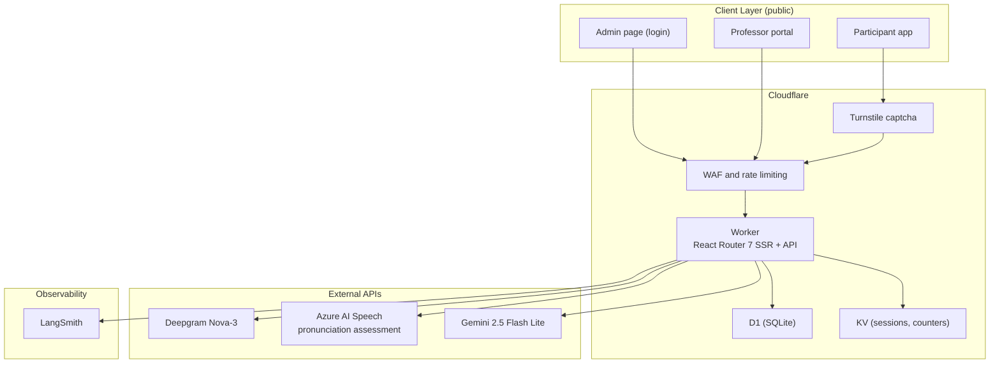
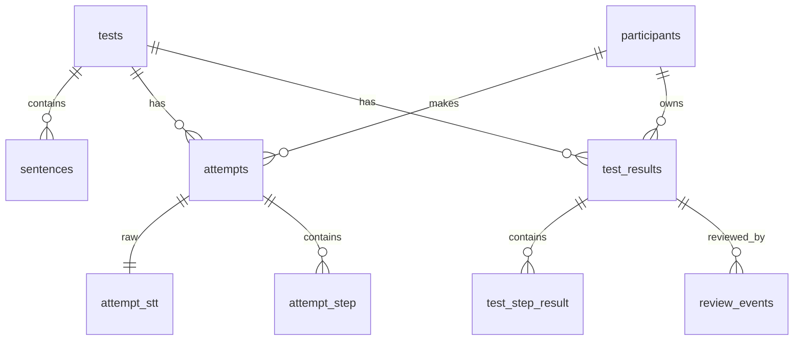
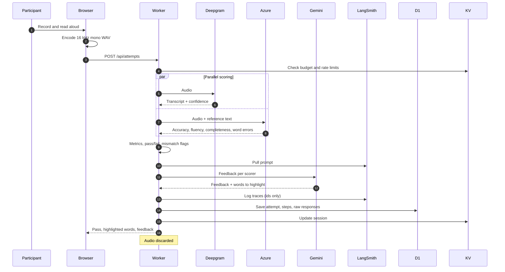
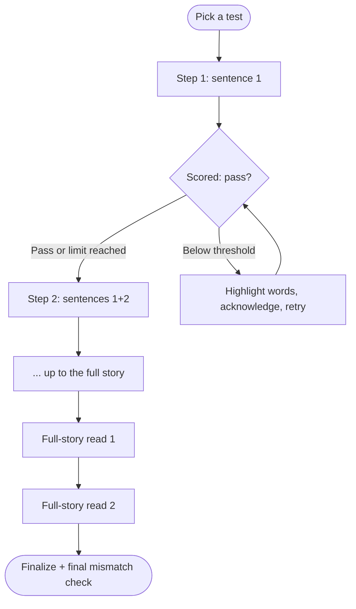
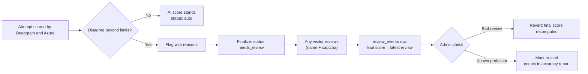
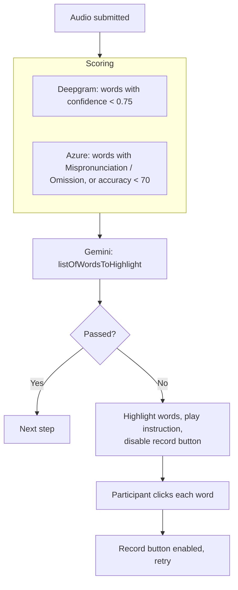
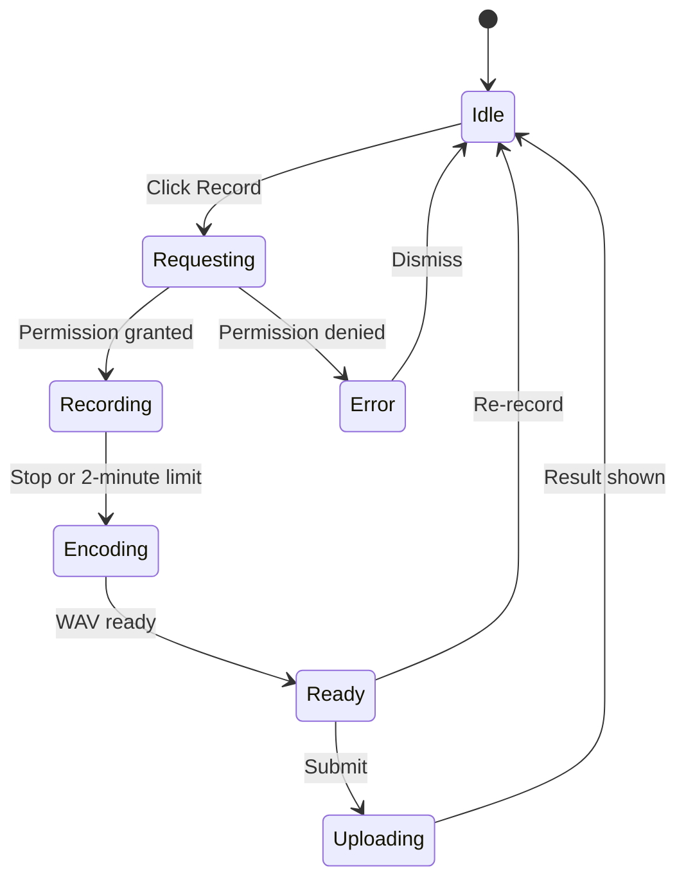
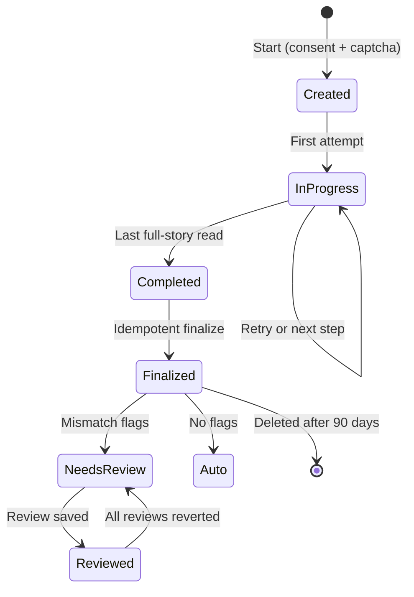
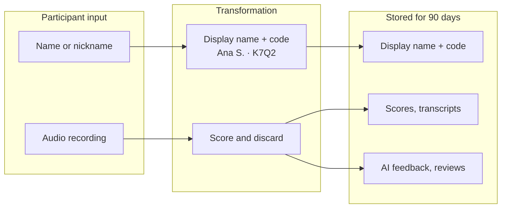

# Read AI - Technical Documentation

## Project Overview

**Read AI** is a public web platform that assesses English reading fluency. A participant reads a short story aloud; two speech engines score every attempt, an LLM writes feedback, and a public professor portal shows the results, flags disagreements between the engines and lets any visitor review them.

It is a portfolio project by Gabriela, built on the design of the ReadAssist AI reading-fluency PoC.

### Key Capabilities

- **Public access** - no login to take a test or open the professor portal; one hidden admin login.
- **Name + code tracking** - participants enter a name or nickname and get a 4-character code (for example "Ana S. · K7Q2").
- **Four graded tests** - original stories at CEFR A2, B1, B2 and C1.
- **Progressive reading** - sentence 1, then 1+2, then 1+2+3, until the full story, then two full-story reads.
- **Dual scoring** - every attempt is scored by Deepgram and by Azure AI Speech pronunciation assessment in parallel.
- **AI feedback** - Gemini 2.5 Flash Lite feedback per scorer, with prompts managed in LangSmith.
- **Word-level feedback** - problem words are highlighted and must be acknowledged before a retry.
- **Mismatch detection** - disagreements between the engines flag a result for review.
- **Public review with audit** - any visitor can review; every review is signed, logged and revertible.
- **Privacy by design (LGPD)** - adults only, name only, no audio storage, 90-day deletion.

---

## System Architecture

### High-Level Architecture Diagram



### Technology Stack

| Layer | Technology | Purpose |
| ----- | ---------- | ------- |
| **Frontend** | React + React Router 7 | UI framework with SSR |
| **Styling** | Tailwind CSS 4 | Utility-first CSS |
| **Backend** | Cloudflare Workers | Serverless edge compute |
| **Database** | Cloudflare D1 (SQLite) + Drizzle ORM | Persistent data |
| **Session Store** | Cloudflare KV | Session state and rate-limit counters |
| **Bot protection** | Cloudflare Turnstile | Captcha |
| **Scorer 1** | Deepgram Nova-3 | Transcript and word confidence |
| **Scorer 2** | Azure AI Speech | Pronunciation assessment against the story text |
| **LLM** | Gemini 2.5 Flash Lite | Feedback generation |
| **Observability** | LangSmith | Tracing and prompt management |

---

## Entity Relationship Diagram (ERD)



### Table Descriptions

| Table | Purpose |
| ----- | ------- |
| `tests` | The 4 reading tests: level, thresholds, retry limit, mismatch limits |
| `sentences` | Sentences of each test, ordered by `sequence_number` |
| `participants` | Display name, code, browser id, consent time, IP hash, hidden flag, delete date |
| `attempts` | One scored recording per step, with metrics from both engines |
| `attempt_step` | Per-sentence detail: skipped, added and highlighted words |
| `attempt_stt` | Raw responses from Deepgram, Azure and Gemini |
| `test_results` | Final result per participant and test: AI scores, final scores, review status, flags |
| `test_step_result` | Aggregated per-step metrics for the details view |
| `review_events` | Every review: reviewer name, trusted flag, old and new values, revert time |
| `admins` | Admin login |
| `usage_daily` | Daily speech minutes, tests started, pause flag |

Full column lists are in the Technical Requirements Document, section 5.

---

## Data Flow Diagrams

### Submit Attempt Flow



### Progressive Reading Flow



### Mismatch and Review Flow



### Word Highlighting Flow



---

## Metrics Calculation

### Deepgram

```typescript
const accuracy = Math.round(mean(words.map(w => w.confidence)) * 100);
const correct = words.filter(w => w.confidence >= 0.75).length;
const wcpm = Math.round(correct / speechSeconds * 60);
const fluency = (accuracy / 100) * meanConfidence * similarityToReference * 100;
```

### Azure

```typescript
const pa = response.NBest[0].PronunciationAssessment;
const accuracy = pa.AccuracyScore;
const fluency = pa.FluencyScore;
const completeness = pa.CompletenessScore;
const correct = response.NBest[0].Words.filter(w => w.PronunciationAssessment.ErrorType === 'None').length;
const wcpm = Math.round(correct / speechSeconds * 60); // speechSeconds from word offsets
```

Steps longer than 30 seconds are split at sentence boundaries; chunk scores are averaged weighted by word count.

### Best-of Metrics and Pass Rule

```typescript
const best = {
  wcpm: Math.max(dg.wcpm ?? 0, az.wcpm ?? 0),
  accuracy: Math.max(dg.accuracy ?? 0, az.accuracy ?? 0),
  fluency: Math.max(dg.fluency ?? 0, az.fluency ?? 0),
};
const passed = best.wcpm >= test.fluencyThreshold
  && best.accuracy >= test.accuracyThreshold
  && best.fluency >= test.fluencyScoreThreshold;
```

### Mismatch Rules (starting limits)

| Flag | Rule |
| ---- | ---- |
| `accuracy_gap` | Accuracy differs by more than 15 points |
| `wcpm_gap` | WCPM differs by more than 25% |
| `verdict_split` | One scorer passes, the other fails |
| `unreliable_input` | Azure completeness < 80 or Deepgram mean confidence < 0.6 |

### Final Score

The final score is the latest non-reverted review; with no review it is the AI best-of score.

---

## Routes and API

### Pages

| Route | Description |
| ----- | ----------- |
| `/` | Landing page |
| `/start` | Name, consent, captcha |
| `/tests` | Test picker |
| `/assessment?testId={id}` | Reading interface |
| `/assessment/completed` | Results, code, portal link |
| `/portal` | Professor portal |
| `/portal/results/{id}` | Result details and review |
| `/privacy` | Privacy notice |
| `/admin` | Admin |

### API Endpoints

| Endpoint | Method | Description |
| -------- | ------ | ----------- |
| `/api/session/start` | POST | Create or resume participant |
| `/api/attempts` | POST | Submit audio for a step |
| `/api/results/:id/finalize` | POST | Idempotent finalize |
| `/api/portal/sessions?status=active\|completed\|needs_review` | GET | Portal lists |
| `/api/results/:id` | GET | Result details |
| `/api/results/:id/reviews` | POST | Submit review |
| `/api/results/:id` | DELETE | Delete own result |
| `/api/export/attempts.csv` | GET | Attempts CSV |
| `/api/export/results.csv` | GET | Results CSV |
| `/api/admin/*` | various | Moderation, revert, trust, usage, kill switch |

---

## External Service Integrations

### Deepgram

- `https://api.deepgram.com/v1/listen` with `model=nova-3`, `language=en-US`, `smart_format=true`.

### Azure AI Speech

- `https://{region}.stt.speech.microsoft.com/speech/recognition/conversation/cognitiveservices/v1?language=en-US`
- `Pronunciation-Assessment` header: `ReferenceText`, `GradingSystem: HundredMark`, `Granularity: Word`, `Dimension: Comprehensive`, `EnableMiscue: true`.
- WAV PCM 16 kHz mono, at most 30 seconds per request.

### Gemini

- `gemini-2.5-flash-lite`, paid tier; two calls per attempt (one per scorer).

**Input:**

```typescript
{
  scorer: 'deepgram' | 'azure',
  result: { wcpm, accuracy, fluency, completeness?, transcript, problemWords },
  expectedSentences: [{ id, content, sequenceNumber }],
  thresholds: { wcpm, accuracy, fluency }
}
```

**Output:**

```typescript
{
  listOfWordsToHighlight: string[],
  feedback: string,
  wordsSkipped: string[],
  wordsAdded: string[]
}
```

### LangSmith

- Prompt pulled from Prompt Hub at runtime (cached 5 minutes); every Gemini call traced with attempt, participant and test ids only.

### Cloudflare Turnstile

- On `/start` and on the review form; verified server-side.

---

## Audio Recording

**Technology:** Web Audio API with an AudioWorklet capturing PCM, encoded to WAV in the browser.

```typescript
{
  sampleRate: 16000,
  channels: 1,
  format: 'audio/wav',
  echoCancellation: true,
  noiseSuppression: true,
  maxDurationSeconds: 120,
  maxBytes: 10 * 1024 * 1024
}
```

WAV is used because Azure's REST endpoint does not accept WebM, and Deepgram accepts WAV.

### Recording State Machine



---

## Session State Management

### KV Keys

| Key | Value | TTL |
| --- | ----- | --- |
| `session:{participantId}:{testId}` | Current step, attempt number, best metrics, highlighted words | 1 hour |
| `tests:{ipHash}:{date}` | Tests started today | 24 hours |
| `reviews:{ipHash}:{date}` | Reviews saved today | 24 hours |
| `paused` | Kill-switch state | none |

### Session Lifecycle



---

## Privacy and LGPD Compliance

### Data Minimisation

- Only a display name (first name + last initial) and a code identify a participant.
- Audio is discarded right after scoring and never played on the portal.
- IP addresses are stored only as salted hashes, for rate limiting and abuse review.
- Retained data: display name, code, scores, transcripts, feedback, reviews.

### Consent and Rights

- Consent gate: 18 or older, results are public; recorded with a timestamp.
- 90-day automatic deletion; "Delete my result" from the creating browser; deletion by request to the admin.
- Privacy notice at `/privacy` naming Gabriela as responsible, with a contact email.

### Third Parties

| Service | Receives |
| ------- | -------- |
| Deepgram, Azure | Audio of the attempt (not stored by Read AI) |
| Gemini, LangSmith | Ids, transcripts, scores, reference text; never names |
| Cloudflare | Hosting, database, captcha |

### Data Flow Privacy



---

## Restrictions

| Restriction | Value |
| ----------- | ----- |
| Age | 18+ (consent gate) |
| Tests per IP per day | 3 |
| Recording | 2 minutes, 10 MB |
| Reviews per IP per day | 20 |
| Names | 2-40 letters, blocked-word filter |
| Review values | Scores 0-100, WCPM 0-300, notes 500 characters plain text |
| Daily speech budget | 80 minutes |
| Retention | 90 days |

---

## Database Migrations

Drizzle ORM migrations in `db/migrations/`:

```bash
npm run db:migrate:local
npm run db:migrate:staging
npm run db:migrate:production
npm run db:seed        # 4 tests, sentences, demo results
```

---

## Environment Configuration

### Environments

| Environment | Worker | D1 | KV |
| ----------- | ------ | -- | -- |
| Local | `wrangler dev` | `local-dev` | preview namespace |
| Staging | staging Worker | `read-ai-staging-db` | staging namespace |
| Production | production Worker | `read-ai-production-db` | production namespace |

### Environment Variables

| Variable | Description |
| -------- | ----------- |
| `DEEPGRAM_API_KEY` | Deepgram key |
| `AZURE_SPEECH_KEY` | Azure Speech key |
| `AZURE_SPEECH_REGION` | Azure region (for example `eastus`) |
| `GEMINI_API_KEY` | Gemini key |
| `GEMINI_TEMPERATURE` | LLM temperature |
| `LANGSMITH_API_KEY` | LangSmith key |
| `LANGSMITH_PROJECT` | LangSmith project name |
| `LANGSMITH_FEEDBACK_PROMPT_ID` | Prompt id in Prompt Hub |
| `TURNSTILE_SITE_KEY` / `TURNSTILE_SECRET_KEY` | Captcha keys |
| `IP_HASH_SALT` | Salt for IP hashing |
| `DAILY_STT_MINUTES_CAP` | Daily budget (default 80) |
| `RETENTION_DAYS` | Retention (default 90) |
| `PRIVACY_CONTACT_EMAIL` | Contact shown on the privacy notice |

---

## Glossary

| Term | Definition |
| ---- | ---------- |
| **Participant** | A member of the public taking a test |
| **Display name + code** | Public identity, for example "Ana S. · K7Q2" |
| **Attempt** | One scored recording of one step |
| **Step** | One progressive read or one full-story read |
| **WCPM** | Words correct per minute |
| **Coach DG / Coach AZ** | Feedback from the Deepgram / Azure result |
| **Mismatch** | Disagreement between the two scorers beyond set limits |
| **Review event** | A stored, signed review; revertible by the admin |
| **Trusted review** | Review by the admin or a trusted reviewer; used in accuracy reporting |
| **Auto-progression** | Moving on after the retry limit regardless of pass |
| **Kill switch** | Admin control that pauses new tests |
| **D1 / KV** | Cloudflare's SQLite database / key-value store |
