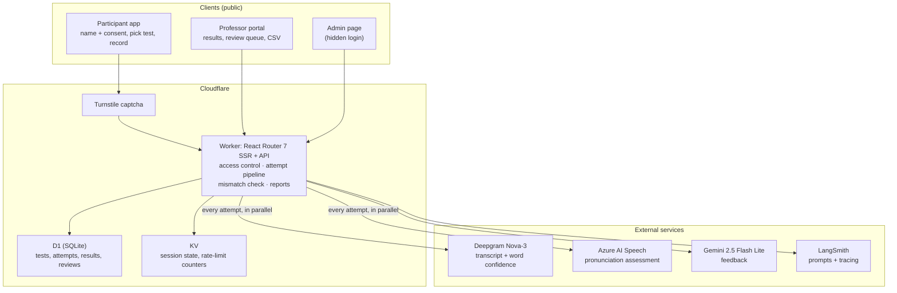
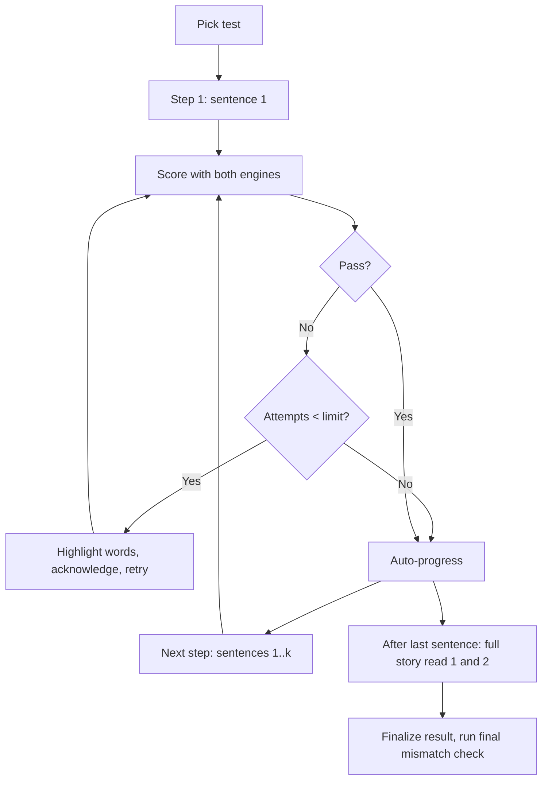
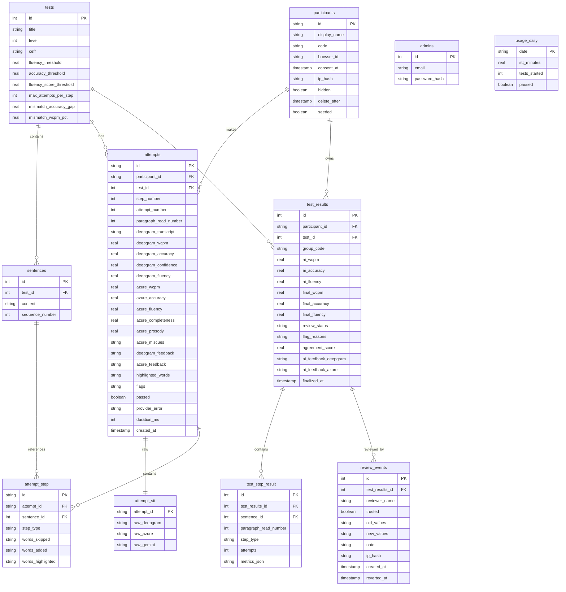

# Read AI - Technical Requirements Document (TRD)

## 1. Cover Page

**Project Name:** Read AI – English Reading Fluency Assessment (Public MVP)  
**Version:** 1.0  
**Date:** October 12, 2026  
**Author:** Gabriela  
**Document Status:** Technical Implementation Specification  
**Based on:** ReadAssist AI TRD v4.2 (November 2025)

---

## 2. Introduction

### 2.1 Document Purpose

This TRD specifies the architecture, technology, data design, integrations, restrictions and delivery plan for Read AI, a public web platform that scores English reading fluency with two speech engines and lets any visitor review results when the engines disagree.

### 2.2 Relationship to BRD

This document implements the Read AI Business Requirements Document (BRD) v1.0, October 12, 2026. Each business requirement (BR) maps to a technical requirement (TR) in section 4.

### 2.3 What Changed from ReadAssist

| Area | ReadAssist PoC | Read AI MVP |
| ---- | -------------- | ----------- |
| Audience | K-12 classrooms (COPPA) | Adults, general public (LGPD) |
| Access | HTTP Basic Auth + URL parameters | Public site; captcha and rate limits; one hidden admin login |
| Identity | First + last name → anonymous id | Name or nickname + 4-character code |
| Tests | 3 fixed passages | 4 stories, CEFR A2-C1, chosen from a menu |
| Second scorer | SpeechAce | Azure AI Speech pronunciation assessment |
| Teacher side | Notes only, per-class dashboards | Public portal, mismatch flags, signed reviews, audit and revert |
| Classes | 5 pre-seeded classes | Optional group code |
| Known bug | Results page errors on reload | Idempotent finalize |

### 2.4 Audience

- Developer (implementation, deployment, operations).
- Technical reviewers of the portfolio project.
- Any future contributor.

---

## 3. Technical Architecture

### 3.1 Architecture Overview

A serverless, edge-first web app on Cloudflare. One Worker serves the React Router 7 app (server-side rendering) and the API. It calls Deepgram and Azure in parallel for every attempt, Gemini for feedback, and stores data in D1 and session state in KV.



### 3.2 Technology Stack

| Layer | Technology | Purpose |
| ----- | ---------- | ------- |
| Frontend | React + React Router 7, Tailwind CSS 4 | UI with server-side rendering |
| Runtime | Cloudflare Workers | API and business logic at the edge |
| Database | Cloudflare D1 (SQLite) + Drizzle ORM | Persistent data, typed queries, migrations |
| Session and counters | Cloudflare KV | Live session state (1-hour TTL), rate-limit counters |
| Bot protection | Cloudflare Turnstile | Captcha on test start and review save |
| Scorer 1 | Deepgram Nova-3 | Transcript, word confidence and timings |
| Scorer 2 | Azure AI Speech pronunciation assessment | Accuracy, fluency, completeness, prosody, word miscues against the reference text |
| LLM | Gemini 2.5 Flash Lite (paid tier) | Feedback and words to highlight |
| Observability | LangSmith | Prompt Hub and tracing |
| Audio capture | Web Audio API (AudioWorklet) | 16 kHz mono PCM, encoded to WAV in the browser |

### 3.3 Technical Justification

- **Reuse:** the ReadAssist stack is proven for this exact workflow; reuse shortens delivery.
- **Cost:** Workers, D1 and KV stay within free limits at the expected volume; Azure replaces SpeechAce and cuts scoring cost from about $125 to about $11 a month.
- **Public safety:** Turnstile, KV counters and the WAF give bot protection and rate limiting without accounts.
- **Audio format:** Azure's REST endpoint accepts WAV (PCM) or OGG/Opus, not WebM. Recording 16 kHz mono WAV in the browser serves both Deepgram and Azure without server-side conversion.

---

## 4. Technical Requirements Mapping

### 4.1 BR-01 → TR-01: AI Listening and Evaluation

```mermaid
sequenceDiagram
    autonumber
    participant P as Participant
    participant B as Browser
    participant W as Worker
    participant DG as Deepgram
    participant AZ as Azure
    participant G as Gemini
    participant LS as LangSmith
    participant DB as D1
    participant KV as KV

    P->>B: Record, read aloud, stop
    B->>B: Encode 16 kHz mono WAV (max 2 min, 10 MB)
    B->>W: POST /api/attempts (audio + step metadata)
    W->>KV: Check budget and rate limits
    par Parallel scoring
        W->>DG: Audio
        DG-->>W: Transcript, word confidence, timings
    and
        W->>AZ: Audio + reference text (split into ≤30 s chunks if needed)
        AZ-->>W: Accuracy, fluency, completeness, word errors
    end
    W->>W: Compute metrics, compare scorers, set flags
    W->>LS: Pull prompt
    par Feedback per scorer
        W->>G: Deepgram result + reference text
        G-->>W: Feedback + words to highlight
    and
        W->>G: Azure result + reference text
        G-->>W: Feedback + words to highlight
    end
    W->>LS: Log traces (participant id only, no name)
    W->>DB: Insert attempt, attempt_step, attempt_stt
    W->>KV: Update session state
    W-->>B: { passed, highlightedWords, feedback, attemptId }
    Note over W: Audio buffer discarded; never stored
```

**Requirements:**

1. Both scorers are called for every attempt. A failed call is retried once; a remaining failure stores `provider_error` for that scorer.
2. Raw responses from Deepgram, Azure and Gemini are stored in `attempt_stt` for debugging.
3. Audio is held in memory only for the request and never written to storage.
4. Pass/fail per step is deterministic: the attempt passes when best-of WCPM, accuracy and fluency all meet the test's thresholds. Gemini provides feedback and the words to highlight.

### 4.2 BR-02 → TR-02: Progressive Reading and Feedback Loop



- Steps for a test with n sentences: n progressive steps + 2 full-story reads.
- Attempt counter resets per step; limit loaded from `tests.max_attempts_per_step`.
- Progress bar has one segment per step.
- Finalize (`POST /api/results/:id/finalize`) is **idempotent**: a repeated call or a page reload returns the existing result instead of failing (fixes the ReadAssist reload bug).

### 4.3 BR-03 → TR-03: Public Access Without Login

- No authentication on participant routes or portal routes.
- Write endpoints (`/api/session/start`, `/api/results/:id/reviews`) require a valid Turnstile token verified server-side.
- Admin routes (`/admin/*`, `/api/admin/*`) require an admin session (email + password hash in `admins`, HTTP-only secure cookie, 12-hour expiry).
- A demo banner on every page: "Public demo — names and scores are visible to everyone."

### 4.4 BR-04 → TR-04: Name-Based Tracking

- `POST /api/session/start` accepts `name`, `consent=true`, `turnstileToken`, optional `groupCode`.
- Name validation: 2-40 characters, letters, spaces, hyphens and apostrophes; blocked-word filter.
- Display name = first word + initial of last word ("Ana Souza" → "Ana S."). Only the display name is stored.
- Code = 4 random characters from an unambiguous set (no 0/O, 1/I/L), unique per display name.
- A random `browser_id` is stored in a cookie and localStorage; the same browser returns as the same participant.
- The results page shows "Ana S. · K7Q2" and a link to the portal entry.

### 4.5 BR-05 → TR-05: Consent Gate

- The start page shows the consent text and a link to the privacy notice.
- The server rejects a start request without `consent=true` and records `consent_at`.
- Turnstile is verified on the server before a participant is created.

### 4.6 BR-06 → TR-06: Four Graded Reading Tests

| Test | Level | Sentences | Words | `fluency_threshold` (WCPM) | `accuracy_threshold` | `fluency_score_threshold` | `max_attempts_per_step` |
| ---- | ----- | --------- | ----- | -------------------------- | -------------------- | ------------------------- | ----------------------- |
| 1 · The Lost Umbrella | A2 | 5 | 55 | 60 | 85 | 60 | 3 |
| 2 · A Market Morning | B1 | 6 | 81 | 80 | 85 | 65 | 3 |
| 3 · The Night Shift | B2 | 6 | 91 | 100 | 88 | 70 | 2 |
| 4 · The Mapmaker's Problem | C1 | 7 | 114 | 120 | 90 | 75 | 2 |

Reading time at pass pace, before retries: about 4.5, 5.5, 5.0 and 5.7 minutes. Thresholds are starting values, calibrated in Sprint 5.

**Content rules:** 5-7 sentences per story (progressive reading grows with the square of the sentence count); full story under 2 minutes at 70 WCPM; no digits or number words (Deepgram smart formatting may write "3" for "three"); common first names only.

**Test 1 · The Lost Umbrella (A2)**

1. Maria takes the bus to work every morning.
2. Today it is raining, so she brings her blue umbrella.
3. At her stop, she runs to the office and forgets it on the seat.
4. In the afternoon, the driver finds the umbrella and keeps it safe.
5. The next day, he smiles and gives it back to her.

**Test 2 · A Market Morning (B1)**

1. Every Saturday, Daniel visits the farmers' market near the old train station.
2. He usually buys fresh bread, a few vegetables, and flowers for his kitchen table.
3. This week, however, he noticed a new stall selling honey from a local farm.
4. The owner explained that her bees collect nectar from apple trees and wild lavender.
5. Daniel tasted a small spoonful and was surprised by its light, sweet flavor.
6. He bought a jar for himself and another as a gift for his neighbor.

**Test 3 · The Night Shift (B2)**

1. Although most of the city was asleep, the hospital's emergency department remained surprisingly busy.
2. Elena, a nurse who had worked night shifts for most of her career, moved calmly between patients.
3. She checked temperatures, answered worried questions, and made sure every medication was given on schedule.
4. Shortly after midnight, an elderly man arrived with chest pain, and the team responded immediately.
5. Thanks to their quick decisions, he was stable within an hour and resting comfortably.
6. When the sun finally rose, Elena felt exhausted but proud of what they had accomplished together.

**Test 4 · The Mapmaker's Problem (C1)**

1. For centuries, mapmakers have faced an unavoidable problem: representing a curved planet on a flat surface.
2. Every projection distorts something, whether it is the size of continents, the shape of coastlines, or the distances between cities.
3. The familiar Mercator map, originally designed for navigation, preserves angles but dramatically exaggerates regions near the poles.
4. Consequently, Greenland appears comparable to Africa, although Africa is many times larger.
5. Alternative projections attempt to balance these compromises, sacrificing accuracy in one dimension to improve another.
6. Choosing a map, therefore, is never entirely neutral; it subtly shapes how we perceive the world's geography.
7. Thoughtful readers should ask not only what a map shows, but also what it inevitably leaves out.

### 4.7 BR-07 → TR-07: Adaptive Word-Level Feedback

- Candidate words: Deepgram confidence below 0.75; Azure word `ErrorType` of Mispronunciation or Omission, or word accuracy below 70.
- Gemini receives both lists and the reference text and returns `listOfWordsToHighlight` (deduplicated, in text order).
- UI: highlighted words in the text, an audio instruction that auto-plays once, record button disabled until every highlighted word is clicked; clicked words change style.
- Highlighted, skipped and added words are stored per step.

### 4.8 BR-08 → TR-08: Professor Portal

- Route `/portal` with three tabs: Active (in progress, best scores of the current session), Completed (best scores across all attempts), Needs review (count badge, oldest first).
- Search by display name or code; filter by test and group code; hidden results excluded.
- Details view `/portal/results/:id`: per-sentence and per-paragraph metrics for Coach DG (Deepgram) and Coach AZ (Azure) side by side, both transcripts aligned to the reference, top 3 problem words, AI feedback from each coach, the original text, flag reasons, review history and the review form.
- Short explanations (tooltips) for WCPM, accuracy, fluency, completeness and each flag reason.
- Seeded demo results (including flagged ones) are loaded at deploy and marked `seeded`.

### 4.9 BR-09 → TR-09: Mismatch Detection

Run after each step and on finalize. Limits are per test (columns on `tests`); starting values:

| Flag | Rule | Starting limit |
| ---- | ---- | -------------- |
| `accuracy_gap` | abs(Deepgram accuracy − Azure accuracy) > limit | 15 points |
| `wcpm_gap` | abs(Deepgram WCPM − Azure WCPM) / max(both) > limit | 25% |
| `verdict_split` | One scorer meets all thresholds, the other does not | — |
| `unreliable_input` | Azure completeness < 80, or Deepgram mean confidence < 0.6 | — |

- A `provider_error` is stored separately and never raises a mismatch flag.
- On finalize, any step or final flag sets `review_status = needs_review` and stores `flag_reasons` (JSON array) and `agreement_score` (0-100).

### 4.10 BR-10 / BR-11 → TR-10: Public Review, Audit and Revert

- `POST /api/results/:id/reviews` with `reviewerName`, `finalWcpm`, `finalAccuracy`, `finalFluency`, `note`, `turnstileToken`.
- Validation: WCPM 0-300, scores 0-100, note max 500 characters, stored as plain text and escaped on render; reviewer name follows name rules.
- Each review inserts a `review_events` row (old and new values, `ip_hash`, timestamp). `test_results.final_*` = latest non-reverted review; `review_status = reviewed`.
- Concurrency: the form sends the `review_events` count it loaded; a stale submit is rejected with the latest state.
- Admin: `POST /api/admin/reviews/:id/revert` sets `reverted_at` and recomputes the final score; `POST /api/admin/reviewers/trust` marks a reviewer name as trusted for future and past reviews.

### 4.11 BR-12 → TR-11: Admin Moderation

- Admin page: recent results and reviews, hide/unhide result, delete result, revert review, trusted reviewers, usage today and this month, kill switch.
- Kill switch writes `paused=true` to `usage_daily` and KV; the start page shows "Demo paused".

### 4.12 BR-13 → TR-12: CSV Export

- `GET /api/export/attempts.csv` and `GET /api/export/results.csv`, display names only, no IP data.
- Results CSV adds `review_status`, `flag_reasons`, AI and final scores, reviewer name, `trusted`.

### 4.13 BR-14 → TR-13: AI Feedback and Prompt Management

- Prompt pulled from LangSmith Prompt Hub at runtime (cached 5 minutes); mustache variables for scorer result, reference text and thresholds.
- Two Gemini calls per attempt (one per scorer) for comparison; output JSON: `listOfWordsToHighlight`, `feedback`, `wordsSkipped`, `wordsAdded`.
- Every call traced in LangSmith with attempt id, participant id, test id, step and scorer; never the display name.

### 4.14 BR-15 → TR-14: Privacy (LGPD)

- Stored per participant: display name, code, browser id, consent time, IP hash (salted SHA-256), hidden flag, delete-after date.
- Daily scheduled Worker deletes participants and all their data past `delete_after` (created + 90 days).
- `DELETE /api/results/:id` allowed when the request's `browser_id` matches; otherwise by admin.
- `/privacy` page: responsible person (Gabriela) and contact email, what is stored, purposes, retention, third parties (Deepgram, Azure, Google, LangSmith, Cloudflare), how to delete.

### 4.15 BR-16 → TR-15: Abuse and Cost Controls

| Control | Implementation |
| ------- | -------------- |
| Captcha | Turnstile token verified server-side on session start and review save |
| Tests per IP | KV counter `tests:{ipHash}:{date}`, max 3 |
| Reviews per IP | KV counter `reviews:{ipHash}:{date}`, max 20 |
| Recording size | Client stops at 2 minutes; server rejects > 10 MB or > 2 minutes |
| Daily budget | `usage_daily.stt_minutes` incremented per attempt; new sessions refused at 80 minutes |
| Kill switch | `usage_daily.paused`, mirrored in KV |
| Input safety | Plain-text storage, output escaping, Content-Security-Policy headers |
| WAF | Cloudflare rate limiting on `/api/*` |

### 4.16 BR-17 → TR-16: Reading Step Metrics

Per step and per scorer: WCPM, accuracy, fluency, attempt count, highlighted, skipped and added words; Azure also completeness and prosody. Aggregated into `test_step_result` on finalize (averages across attempts).

### 4.17 BR-18 → TR-17: Guided Demo Experience

Landing page explaining both sides, demo banner, seeded results, tooltips on the portal, and a one-minute microphone check before the first recording.

---

## 5. Data Design

### 5.1 Entity Relationship Model



### 5.2 Changes from the ReadAssist Schema

| Table | Change |
| ----- | ------ |
| `teachers`, `classes` | Removed; replaced by `admins` and an optional `group_code` on results |
| `participants` | New: public name-based identity, consent and retention |
| `tests` | Added `level`, `cefr`, `fluency_score_threshold`, mismatch limits |
| `attempts`, `attempt_step`, `attempt_stt` | `speechace_*` columns replaced by `azure_*`; added completeness, prosody, miscues, flags, provider error |
| `test_results` | Added AI vs final scores, review status, flag reasons, agreement score |
| `review_events` | New: audit trail for every review |
| `usage_daily` | New: daily budget and kill switch |

---

## 6. External Services Integration

### 6.1 Deepgram

- **Endpoint:** `https://api.deepgram.com/v1/listen?model=nova-3&language=en-US&smart_format=true`
- **Auth:** API key header. **Audio:** WAV 16 kHz mono.
- **Use:** transcript, per-word confidence and timings. Accuracy = mean confidence × 100; WCPM = words with confidence ≥ 0.75 per minute of speech; fluency = accuracy × confidence × similarity to the reference.

### 6.2 Azure AI Speech Pronunciation Assessment

- **Endpoint (REST, short audio):** `https://{region}.stt.speech.microsoft.com/speech/recognition/conversation/cognitiveservices/v1?language=en-US`
- **Header** `Pronunciation-Assessment` (base64 JSON): `ReferenceText`, `GradingSystem: HundredMark`, `Granularity: Word`, `Dimension: Comprehensive`, `EnableMiscue: true`.
- **Audio:** WAV PCM 16 kHz mono; **at most 30 seconds per request**.
- **Use:** AccuracyScore, FluencyScore, CompletenessScore, prosody where available, per-word ErrorType (None, Mispronunciation, Omission, Insertion). WCPM = words with ErrorType None ÷ speech duration (from word offsets) × 60.
- **Long audio:** steps longer than 30 seconds are split at sentence boundaries using Deepgram word timings; each chunk is scored with its reference sentences, and scores are averaged weighted by word count. Sprint 1 spike confirms this, or a WebSocket alternative that runs on Workers.

### 6.3 Gemini

- **Model:** `gemini-2.5-flash-lite`, paid tier. About 900 input and 500 output tokens per call; two calls per attempt.

### 6.4 LangSmith

- Prompt Hub for the feedback prompt; tracing of every Gemini call with ids only.

### 6.5 Cloudflare Turnstile

- Widget on the start page and review form; token verified with the siteverify endpoint.

---

## 7. User Interface Standards

### 7.1 Design System

- React Router 7 + Tailwind CSS 4; desktop-first, works at 1366 × 768 and on Chromebooks; WCAG 2.1 AA.

### 7.2 Routes

| Route | Purpose |
| ----- | ------- |
| `/` | Landing: what Read AI is, links to "Take a test" and "Open the portal" |
| `/start` | Name, consent, captcha |
| `/tests` | Choose one of 4 tests |
| `/assessment?testId={id}` | Recording and progressive steps |
| `/assessment/completed` | Scores, feedback, display name + code, portal link |
| `/portal` | Active, Completed, Needs review; search; CSV |
| `/portal/results/{id}` | Details, review history, review form |
| `/privacy` | Privacy notice |
| `/admin` | Admin login and moderation |

### 7.3 API Endpoints

| Endpoint | Method | Description |
| -------- | ------ | ----------- |
| `/api/session/start` | POST | Create or resume participant (captcha, consent) |
| `/api/attempts` | POST | Submit audio for a step |
| `/api/results/:id/finalize` | POST | Idempotent finalize and final mismatch check |
| `/api/portal/sessions?status=` | GET | Active, completed or needs-review lists |
| `/api/results/:id` | GET | Result details |
| `/api/results/:id/reviews` | POST | Submit a review (captcha) |
| `/api/results/:id` | DELETE | Delete own result (matching browser) |
| `/api/export/attempts.csv` | GET | Attempts report |
| `/api/export/results.csv` | GET | Final results report |
| `/api/admin/*` | various | Hide, delete, revert, trust, usage, kill switch |

---

## 8. Security, Privacy and Restrictions

### 8.1 LGPD Compliance

- Legal basis: consent, recorded with timestamp.
- Data minimisation: display name and code only; no audio; IP stored only as a salted hash.
- Retention: 90 days, automatic deletion; deletion on request.
- Transparency: privacy notice naming Gabriela as responsible, with a contact email.
- Third parties receive no names: Deepgram and Azure receive audio only; Gemini and LangSmith receive ids, transcripts and scores.

### 8.2 Restrictions (summary)

| Restriction | Value |
| ----------- | ----- |
| Age | 18+ via consent gate |
| Tests per IP per day | 3 |
| Recording | max 2 minutes, 10 MB |
| Reviews per IP per day | 20 |
| Names | 2-40 letters, blocked-word filter |
| Scores in reviews | 0-100; WCPM 0-300 |
| Notes | max 500 characters, plain text |
| Daily speech budget | 80 minutes |
| Retention | 90 days |

### 8.3 Security Measures

- HTTPS only; HSTS; Content-Security-Policy; output escaping.
- Admin: password hash (bcrypt or scrypt), HTTP-only secure cookies, login rate limit.
- Secrets in Worker environment variables, never in the client.
- No direct database access from the client.

---

## 9. Testing Strategy

### 9.1 Approach

- **Unit (Vitest):** metric calculations, mismatch rules, display-name and code generation, validation, idempotent finalize.
- **Integration:** mocked Deepgram, Azure and Gemini responses; Azure chunking and averaging.
- **End-to-end (Playwright):** full test flow with recorded fixture audio; review, revert and delete flows.
- **Abuse tests:** rate limits, captcha bypass attempts, oversized audio, script injection in names and notes.
- **Manual:** Chrome, Edge, Firefox, Safari and a Chromebook; several microphones and accents.
- **Calibration:** run seeded and dry-run data to tune mismatch limits and thresholds.

### 9.2 Acceptance Criteria

- A participant completes each of the 4 tests on production.
- Both scorers return results for every attempt, or a logged provider error.
- Flagged results appear in Needs review with reasons; a review updates the final score and can be reverted.
- Reload of the results page never errors.
- All restrictions in 8.2 are enforced server-side.
- No audio persisted; no names in LangSmith traces.

---

## 10. Technical Roadmap

### 10.1 Sprint Plan (12 weeks)

| Sprint | Weeks | Deliverables |
| ------ | ----- | ------------ |
| 1 · Setup and data model | 1-2 | Cloudflare environments (local, staging, production); D1 schema + migrations; seed 4 tests; Turnstile and rate limits; consent page and privacy notice; LangSmith project; Azure long-audio spike |
| 2 · Participant flow | 3-4 | Name + code entry; test picker; WAV recording; progressive steps; word highlighting and acknowledgment; KV session state |
| **Gate A** | | A participant finishes a full test on staging |
| 3 · Scoring pipeline | 5-6 | Parallel Deepgram + Azure; WCPM, accuracy, fluency, completeness; Gemini feedback; idempotent finalize; provider-error handling and retry |
| 4 · Public portal and review | 7-8 | Portal tabs, search, details view, CSV; mismatch check; signed reviews, audit log and revert; admin moderation and kill switch |
| **Gate B** | | Feature complete; final 4 stories loaded |
| 5 · QA and calibration | 9-10 | Browser and microphone tests; abuse and load tests; LGPD review; dry run; tune mismatch limits and prompts |
| 6 · Launch and handover | 11-12 | Public launch with seeded demo results; budget cap live; AI-vs-trusted-review accuracy report |
| **Gate C** | | MVP sign-off |

---

## 11. Infrastructure Cost Analysis

**Assumptions:** 50 users a month, 2 tests each, about 8 audio minutes per test with retries (800 minutes, about 13 hours). Prices to recheck on vendor pricing pages before launch.

| Service | Usage | Monthly cost |
| ------- | ----- | ------------ |
| Azure AI Speech pronunciation assessment | about 13 hours; first 5 free, then about $1.32 per hour | about $11 |
| Deepgram Nova-3 | 800 minutes at $0.0043 | about $3.50 |
| Gemini 2.5 Flash Lite (paid) | about 1,400 calls | under $1 |
| LangSmith Developer | about 1,400 traces of 5,000 free | $0 |
| Cloudflare Workers, D1, KV, Turnstile | within free limits | $0 |
| **Total** | | **about $15** |

**Worst case:** the 80-minute daily budget caps a fully used month at about 2,400 minutes, roughly $60 (Azure about $50, Deepgram about $10).

For comparison, the ReadAssist design with SpeechAce Premium would cost about $130 a month at the same volume.

---

## 12. Future Enhancements

- Choose a single scorer after enough trusted-review data.
- Phoneme-level feedback using Azure phoneme scores.
- Text-to-speech pronunciation models for highlighted words.
- Participant history across tests; more stories per level.
- Reviewer accounts for professors, replacing name-signed reviews.
- Analytics dashboard for AI-vs-human agreement.

---

## 13. Appendices

### 13.1 Technical Glossary

| Term | Definition |
| ---- | ---------- |
| **Attempt** | One recording of one step, scored by both engines |
| **Step** | One progressive read (sentences 1..k) or one full-story read |
| **Coach DG / Coach AZ** | Feedback generated from the Deepgram / Azure result |
| **Best-of metrics** | The higher of the two scorers' values for WCPM, accuracy and fluency |
| **Mismatch flag** | A rule in TR-09 that fired for an attempt or result |
| **Agreement score** | 0-100 measure of how closely the two scorers agree |
| **Provider error** | A scorer that failed after one retry; not a mismatch |
| **Review event** | One stored review with old and new values |
| **Trusted review** | A review by the admin or a trusted reviewer name |
| **Idempotent finalize** | Finalize that returns the same result on repeat calls |
| **D1 / KV** | Cloudflare's SQLite database / key-value store |
| **Turnstile** | Cloudflare's captcha |

### 13.2 External Documentation

1. Read AI Business Requirements Document (BRD) v1.0, October 12, 2026
2. [Deepgram API documentation](https://developers.deepgram.com)
3. [Azure AI Speech pronunciation assessment](https://learn.microsoft.com/azure/ai-services/speech-service/how-to-pronunciation-assessment)
4. [Azure AI Speech pricing](https://azure.microsoft.com/pricing/details/cognitive-services/speech-services/)
5. [Gemini API documentation](https://ai.google.dev/gemini-api/docs)
6. [Cloudflare developer documentation](https://developers.cloudflare.com)
7. [Cloudflare Turnstile](https://developers.cloudflare.com/turnstile/)
8. [LangSmith documentation](https://docs.smith.langchain.com/)

### 13.3 Revision History

| Version | Date | Author | Changes |
| ------- | ---- | ------ | ------- |
| 1.0 | October 12, 2026 | Gabriela | Read AI TRD created from the ReadAssist AI TRD v4.2: public access, captcha and rate limits, admin login, name + code identity, 4 graded tests with texts, Azure pronunciation assessment replacing SpeechAce, WAV recording, mismatch detection, public review with audit and revert, LGPD privacy, new schema, 12-week sprint plan, updated costs. |
